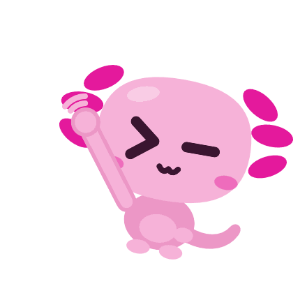
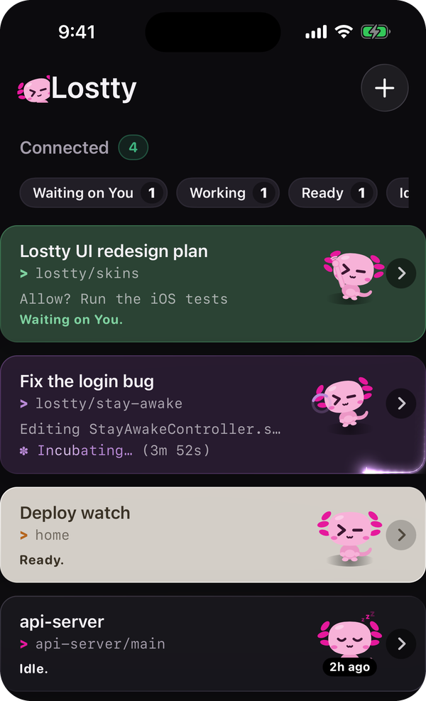
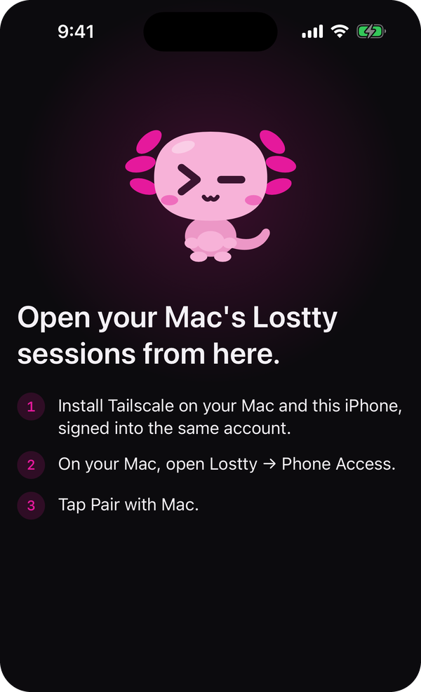
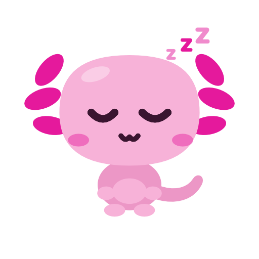

<p>
  
</p>

# Lostty — Leave Your Desk, Not Your Terminal

[](LICENSE)
[](#getting-started)

The terminal I use every day to run Claude Code and Codex — on my Mac, and on my iPhone when I walk away from it.

Coding agents work best when you let them run. The trouble is, they don't run for long before they need you. They stop to ask for permission, or to ask a question, and then they wait. If you've stepped away, they wait for a long time.

Screen sharing puts a tiny Mac on your phone that you have to pinch and squint at. A plain SSH app gets you a shell, but no idea which of your ten terminals actually needs you.

Lostty is a fast, native Mac terminal with an iPhone app built for exactly this. Every terminal keeps running on your Mac. Your phone shows you which one needs you, and you answer it right there. Then the phone goes back in your pocket.

<p>
  
  &nbsp;&nbsp;
  
</p>

## Getting Started

Three parts: the Mac app, the iPhone app, then pairing them. The first build takes a while; after that it's quick.

**You'll need:** a Mac on macOS 15 or later, an iPhone on iOS 17 or later with its cable, and a free [Apple Account](https://account.apple.com).

### Part 1: The Mac app

1. **Install Xcode 26** from the [App Store](https://apps.apple.com/app/xcode/id497799835). Open it once, and let it install what it asks for.
2. **Install the tools** in Terminal (needs [Homebrew](https://brew.sh)):

   ```sh
   sudo xcode-select --switch /Applications/Xcode.app
   xcodebuild -downloadComponent MetalToolchain
   brew install zig@0.15 tmux
   ```

3. **Get Lostty:**

   ```sh
   git clone https://github.com/Lawliang/lostty.git
   cd lostty
   ```

4. **Build and install it:**

   ```sh
   macos/install-skins.sh
   ```

   Lostty is now in `/Applications`. Open it.

> **Updating later:** `git pull`, run `macos/install-skins.sh` again, then choose **Restart to Update** in Lostty's menu bar. Don't Quit Lostty to update: quitting ends every terminal session.

### Part 2: The iPhone app

1. **Sign in to Xcode:** **Xcode → Settings → Accounts**, click **+**, and add your Apple Account.
2. **Plug your iPhone into the Mac** and tap **Trust** on the phone.
3. **Open the project:** `open macos/Lostty.xcodeproj`
4. **Pick what to build:** in the bar at the top of the window, choose the **Lostty-iOS** scheme, then your iPhone.
5. **Sign it as you:** click **Lostty** at the top of the left sidebar, choose the **Lostty-iOS** target, and open **Signing & Capabilities**.
   - **Team:** pick your name.
   - **Bundle Identifier:** change `com.lawliang` to anything of your own, like `com.yourname.lostty-mobile`. Each identifier can belong to only one Apple Account.
6. **Press Run (▶).** On the phone, if asked:
   - turn on **Settings → Privacy & Security → Developer Mode**, and restart the phone;
   - trust yourself in **Settings → General → VPN & Device Management**.

> **With a free Apple Account,** the app stops opening after 7 days. Plug in and press Run again to renew it. A paid developer account makes it last a year.

### Part 3: Pair them

1. **Install [Tailscale](https://tailscale.com/download)** on the Mac and the iPhone, and sign in to both with the same account.
2. **On the Mac,** open **Lostty → Phone Access…** and fix any row without a ✓. Each row says what to click.
3. **Click Pair a Phone…** On the iPhone, open Lostty, tap **Pair with Mac**, and scan the code. Click **Allow** on the Mac.

<details>
<summary><strong>Why Tailscale?</strong></summary>

Your phone talks to your Mac directly, over SSH, inside your own private Tailscale network. There's no Lostty server in the middle. There isn't one. And the phone's SSH key never leaves the phone.

If you'd rather set up the Mac by hand, the steps Phone Access automates are in [docs/lostty-mobile-host-setup.md](docs/lostty-mobile-host-setup.md).

</details>

### That's it. Go take a walk.

Your phone reaches the Mac while it's awake and Lostty is open. To keep it reachable with the lid closed, see [Lostty on your iPhone](docs/lostty-mobile-phone-access.md).

## Why Lostty Exists

I built Lostty to fix the things that kept going wrong whenever I left an agent running and walked away.

### #1: The Agent Stopped, And I Didn't Know

**The Problem**: You start Claude on something big. You go make a coffee. Twenty minutes later you come back, and it's been sitting on a permission prompt for nineteen of them.

**The Fix**: Lostty knows what every terminal is doing. Your phone sorts them into **Waiting on you**, **Working**, **Ready** and **Idle**, so the one that needs you is always first. Tap in, answer, and Claude carries on. Anything that waited on you while you were busy lands in the inbox under the bell.

The axolotl tells you at a glance, too. It has a prompt for eyes (`>` and a blinking `—` cursor):

<table>
  <tr>
    <td align="center"><br><sub>Waiting on you</sub></td>
    <td align="center"><br><sub>Ready</sub></td>
    <td align="center"><br><sub>Idle</sub></td>
  </tr>
</table>

### #2: My Phone Got A Tiny, Useless Mac

**The Problem**: Screen sharing works, technically. But you're pinching around a 27-inch screen on a 6-inch phone, and typing into it is miserable.

**The Fix**: Lostty's phone app is a real terminal. It opens the same session that's running on your Mac: same output, same prompt, same half-typed command. Come back to your Mac and carry on. Nothing restarts.

The keyboard is made for it, too. A tap that lands in the gap between two keys types the nearest one, instead of nothing.

> [!TIP]
> Turn on **Stay Awake** in Lostty's menu bar before you leave:
>
> - Your Mac **keeps working with the lid closed**, even on battery
> - If its Wi-Fi drops, it **hops onto your iPhone's hotspot**, so you can still reach it

### #3: Ten Terminals, All The Same Black Box

**The Problem**: Once you've got a few agents going, every terminal looks the same. Sooner or later, you type into the wrong one.

**The Fix** is skins. Each project gets its own colors and texture, and the terminal changes to match when you move into a project. Pick from twelve built-in skins, or make your own. Your phone shows the same colors, so the list reads at a glance.

Each terminal also says what Claude is doing right now, in plain words, like _Editing App.swift_, with its live _✳ Working…_ line. And a soft glow traces the window while Claude works, so you can tell from across the room.

### #4: Starting Anything Meant Going Back To My Desk

**The Problem**: You're out, and you think of the next thing. Now you either wait until you're back, or you go back.

**The Fix**: Tap **+** on your phone and pick a project folder on your Mac (browse for it, or search). Choose what starts there: Claude, Codex or a plain shell, and which model. It opens on your Mac and on your phone at the same time.

### Summary

Agents are good enough now to keep working while you're gone. Lostty is my attempt at making "gone" actually work: you leave, and your terminals come with you. Enjoy.

## Built On Ghostty

Lostty started from [Ghostty](https://ghostty.org), the fast, native terminal by Mitchell Hashimoto and the Ghostty contributors. Every character you see is drawn by Ghostty's engine, which does the hard part quickly and correctly. Lostty adds the Mac and iPhone side on top.

If you love how fast Lostty feels, that's Ghostty. Go give it a star.

## Reference

- **[HACKING.md](HACKING.md)**: Build, test and debug Lostty. Start here if you want to change something.
- **[SKINS.md](SKINS.md)**: The twelve built-in skins, project skins, and how to make your own.
- **[Lostty on your iPhone](docs/lostty-mobile-phone-access.md)**: How pairing works, and what Phone Access sets up on your Mac.
- **[Manual Mac setup](docs/lostty-mobile-host-setup.md)**: The steps Phone Access automates, for setting up by hand.
- **[UPGRADING.md](UPGRADING.md)**: Merging a new Ghostty release into Lostty.
- **[CONTRIBUTING.md](CONTRIBUTING.md)**: Reporting bugs and sending changes.

## License

MIT, like Ghostty before it. See [LICENSE](LICENSE).
