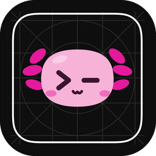
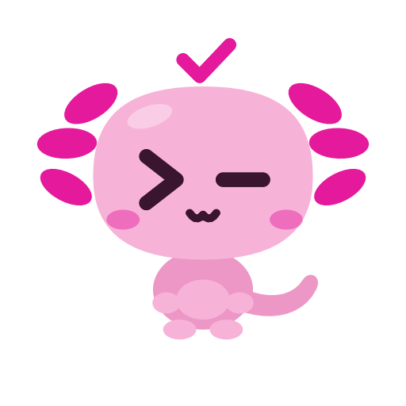

<p align="center">
  
</p>

<h1 align="center">Lostty</h1>

<p align="center">
  <b>Leave your desk, not your terminal.</b>
  <br>
  A fast, native terminal for the Mac that follows you to your iPhone.
  <br>
  Made for working with Claude Code.
</p>

<p align="center">
  <a href="#what-you-can-do">What you can do</a>
  ·
  <a href="#get-started">Get started</a>
  ·
  <a href="#built-on-ghostty">Built on Ghostty</a>
  ·
  <a href="HACKING.md">Developing</a>
</p>

<br>

Start something on your Mac. Walk away. Lostty keeps every terminal running,
and your iPhone shows you exactly where each one is. When Claude needs you,
you'll know, and you can answer from wherever you are.

<p align="center">
  
  &nbsp;&nbsp;
  
</p>

## What you can do

### Pick up right where you left off

- Every terminal keeps running on your Mac while you're away from it.
- Open it on your iPhone and it's exactly as you left it: same output, same
  prompt, same half-typed command.
- Come back to your Mac and carry on. Nothing restarts.

### See what Claude is doing, at a glance

- Each terminal shows Claude's current step in plain words, like
  _Editing App.swift_, along with its live _✳ Working…_ line.
- A soft glow traces the window while Claude works, so you can tell from
  across the room.
- When Claude stops to ask for your OK, the terminal says so. Your phone
  sorts everything into **Waiting on you**, **Working**, **Ready** and
  **Idle**, so you know which one needs you first.
- Tap in and answer from the phone. Claude carries on.

### Start a new terminal from your phone

- Tap **+**, pick a project folder on your Mac (browse, or search for it).
- Choose what starts there: Claude, Codex, or a plain shell, and which model.
- It opens on your Mac and on your phone at the same time.

### Give every project its own look

- Skins give each terminal its own colors and texture, so you always know
  which project you're in.
- Move into a project and the terminal changes to match. Pick from a dozen
  built-in skins or make your own.
- Your phone shows the same colors, so the list reads at a glance.
  More in [SKINS.md](SKINS.md).

## Meet the axolotl

Lostty's mascot has a prompt for eyes (`>` and a blinking `—` cursor) and
shows up all over the app to tell you how each terminal is doing.

<table align="center">
  <tr>
    <td align="center"><br><sub>Waiting on you</sub></td>
    <td align="center"><br><sub>Ready</sub></td>
    <td align="center"><br><sub>Idle</sub></td>
  </tr>
</table>

## Get started



**1. Build the Mac app.** You'll need Xcode 26, Zig 0.15, Nushell and tmux
(`brew install zig@0.15 nushell tmux`). Then:

```sh
zig build -Demit-macos-app=false
macos/build.nu --configuration Release
```

**2. Put Lostty on your iPhone.** Open `macos/Lostty.xcodeproj` in Xcode,
pick the `Lostty-iOS` scheme and your phone, and press Run.

**3. Pair them.** Install [Tailscale](https://tailscale.com) on your Mac and
your iPhone, signed in to the same account. On the Mac, open
**Lostty → Phone Access**. It checks that everything's ready, then shows a
QR code. Scan it with your phone, and you're in.

Your phone connects to your Mac securely over SSH, and its key never leaves
the phone.

Full build, test and debugging notes are in [HACKING.md](HACKING.md).

## Built on Ghostty

Lostty began as a fork of [Ghostty](https://ghostty.org), the fast,
native terminal by Mitchell Hashimoto and the Ghostty contributors. Every
character you see is drawn by Ghostty's engine (libghostty), which does the
hard part quickly and correctly. Lostty adds the Mac and iPhone experience on
top: terminals that follow you, Claude at a glance, and skins.

If you love Lostty's speed and polish, that's Ghostty. Go give it a star.

## License

Lostty is open source under the MIT License, like Ghostty before it. See
[LICENSE](LICENSE).

<br>

<p align="center">
  
  <br>
  <sub>Go take a walk. Your terminals will be right here.</sub>
</p>
